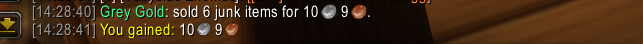
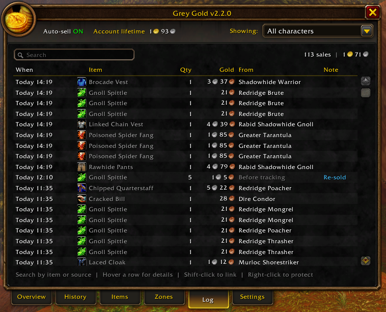
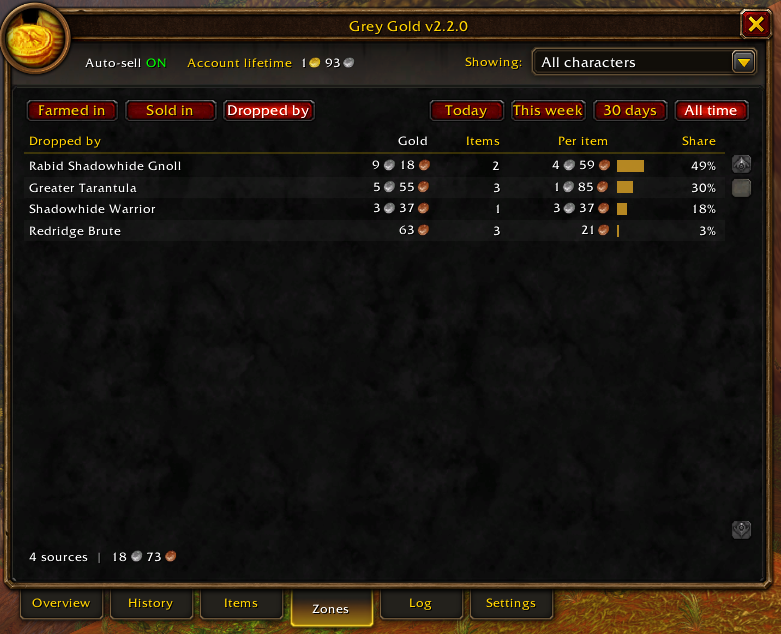
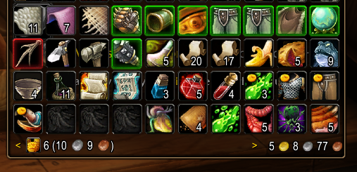
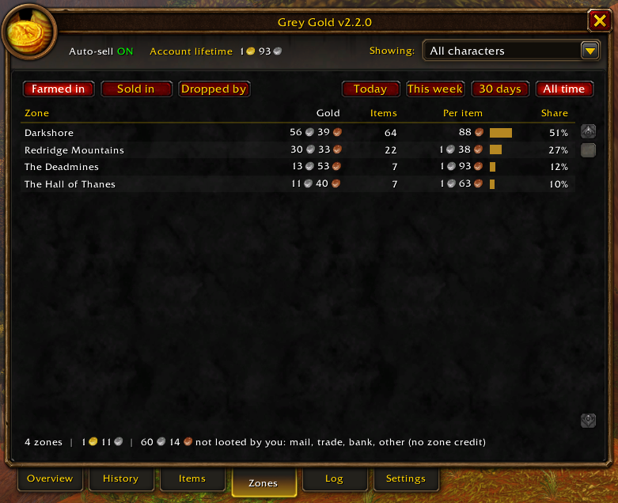
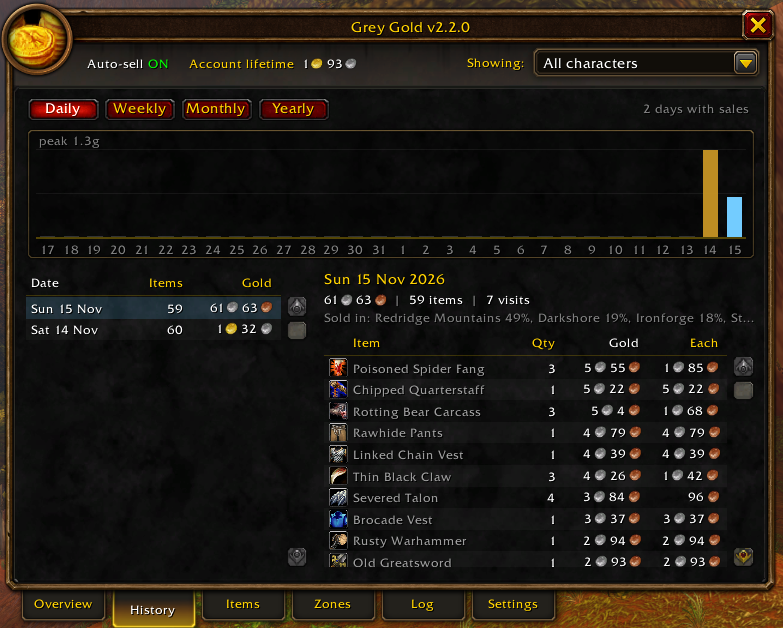
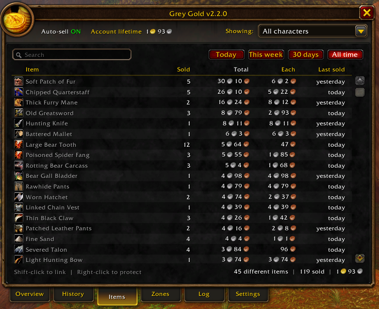
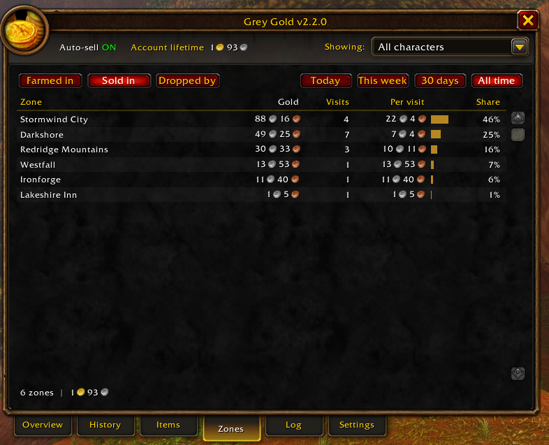
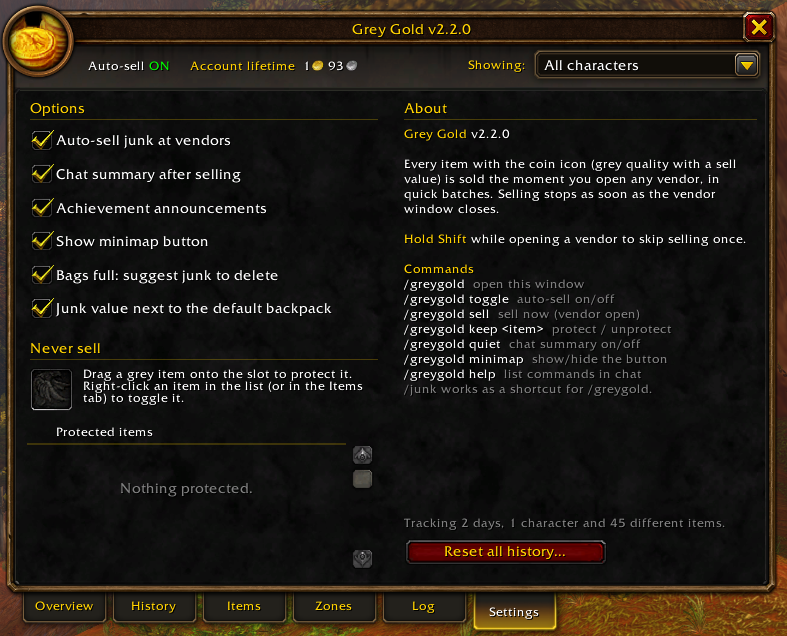

<p align="center">
  
</p>

# Grey Gold (WoW Forever)

**Your grey items are worth more than you think. Grey Gold sells them for you and shows you where every copper came from.**

**[Get Grey Gold on CurseForge](https://www.curseforge.com/wow/addons/grey-gold)**

Open any vendor and your junk is gone, sold in a second, with nothing to click. Then comes the fun part: Grey Gold remembers which mob dropped each item, which zone you farmed it in and when you sold it. After a few weeks you can see that the Defias in Westfall paid for your first mount, or that fishing in Stormwind barely earned you a silver.

<p align="center">
  
</p>

## What you get

### Never click junk again
- Every grey item with a sell value is sold the moment you open a vendor. These are the items that show the gold coin icon.
- Hold **Shift** while opening the vendor to keep your junk that one time.
- Put items you want to keep on the **never-sell list**. Grey gear in your bags is junk too, so add grey transmog pieces before your first vendor visit; they are safe there forever.
- Sold something by mistake? Buy it back from the vendor's **Buyback** tab as usual (the game keeps your last 12 sold stacks until you log out). Grey Gold notices and takes the sale out of your totals.
- Grey items you sell by hand count too, so your numbers are right however you play.

<p align="center">
  
</p>

### See where your gold comes from
- **Which mobs paid you most.** A "Dropped by" list ranks every mob, chest and fishing catch by the junk gold it gave you.
- **Which zones your junk gold came from.** "Farmed in" shows the gold from junk you looted in each zone. "Sold in" shows where you cashed it in. These are totals of the junk you sold, counted when you sold it; they don't measure gold per hour or the rest of your loot.
- **A log of every sale.** Date and time, item, gold, and where it came from: "3 Broken Fangs, looted from Kobold Miner in Elwynn Forest, sold in Stormwind at 14:32". Search it by item or by mob.
- **Your best junk.** A leaderboard of every grey item you've sold, for today, this week, the last 30 days or all time.

<p align="center">
  
</p>
<p align="center">
  
</p>

### A history that lasts for years
- Browse your income by **day, week, month or year**, each with a chart and the items sold in that period.
- Daily and monthly totals are kept for as long as you play, and they are compact, so the save file stays small.
- Records to beat: best day, best week, best month, biggest single vendor visit, priciest sale and your selling streak.
- View all your characters together, or one at a time.

### Achievements
- Fifteen milestones from your first **10 silver** up to **200 gold**, then one every 100 gold. Each has its own title: you start at **Pocket Change**, pass **Trash Baron** at 45 gold, and end up a **Grey Gold Magnate**.
- Each one is announced in chat with a coin sound (you can turn that off).
- The **Achievements** window shows every milestone, the date and time you reached it, which character got there, and how far you are from the next one.

### Always know what's in your bags
- **Works with Bagnon.** Grey Gold shows how many junk items you carry and what they're worth in the data bar at the bottom of Bagnon's bag window, next to a gold coin: "6 (10s 9c)". Other addons that show data feeds can display it too.
- Using the default bags? A small junk label sits next to your backpack.
- When your bags fill up, a chat line names your cheapest junk stack, so you know what to throw away. Grey Gold never deletes anything itself.

<p align="center">
  
</p>

## Installation

Pick **one** of the two ways below. Option A is the easiest.

### Option A: with the CurseForge app (easiest)

1. Install the free [CurseForge app](https://www.curseforge.com/download/app) and open it.
2. Choose **World of Warcraft**, then make sure **Forever** is selected as the game version (not Retail or Classic).
3. Search for **Grey Gold** and click **Install**.
4. Start (or fully restart) WoW. Done! The app also keeps the addon updated for you.

### Option B: install it yourself

1. **Download the zip.** Get the latest file from [Grey Gold's CurseForge page](https://www.curseforge.com/wow/addons/grey-gold) (**Files** tab).

2. **Find your AddOns folder.** Open the Battle.net app, select **World of Warcraft**, choose **WoW Forever** as the version, click the **gear icon** next to the Play button, and choose **Show in Explorer** (Mac: **Show in Finder**). In the folder that opens, go to:

   ```
   _forever_ > Interface > AddOns
   ```

   If `Interface` or `AddOns` doesn't exist yet, create it yourself (right-click > New > Folder). The names must be spelled exactly like this.

   > The usual location on Windows is `C:\Program Files (x86)\World of Warcraft\_forever_\Interface\AddOns`, and on Mac it's `/Applications/World of Warcraft/_forever_/Interface/AddOns`.

3. **Copy the addon in.** Open the zip (double-click it). Inside is a folder called `GreyGold`. Drag that **folder** into your `AddOns` folder.

   When you're done, it must look exactly like this:

   ```
   AddOns
   └── GreyGold
       ├── GreyGold.toc
       ├── GreyGold.lua
       └── ... (the other files)
   ```

   **Common mistakes:**
   - A folder inside a folder, like `AddOns\GreyGold\GreyGold\...` or `AddOns\GreyGold-2.0.0\GreyGold\...`. Move the inner `GreyGold` folder up so it sits directly in `AddOns`.
   - The wrong folder name. Downloads from GitHub are called something like `...-main`. Rename the folder to exactly `GreyGold`, or WoW won't load it.
   - The files dropped loose into `AddOns` without the `GreyGold` folder around them.

4. **Restart WoW completely.** Close the game and start it again; typing `/reload` is not enough for a newly installed addon.

5. **Check that it's turned on.** On the character select screen, click **AddOns** (bottom left) and make sure **Grey Gold** is ticked. If it says *Out of date*, tick **Load out of date AddOns** at the top of that list.

## Getting started

You don't need to set anything up. Just play:

1. **Open any vendor.** Your grey junk is sold right away, and a chat message tells you how much you earned.
2. **Open the stats window.** Click the **gold coin button** on your minimap, or type `/greygold`.
3. **Protect an item you want to keep.** Open the **Settings** tab and drag the item onto the **Never sell** slot.
4. **Look around after a few vendor trips.** The **Log** and **Zones** tabs fill up as you loot and sell.

### Something not working?

| Problem | What to do |
| --- | --- |
| Grey Gold isn't in the AddOns list | Check the folder layout in step 3 above, then fully restart WoW. |
| It's in the list but marked *Out of date* | Tick **Load out of date AddOns** on the AddOns screen. |
| Nothing gets sold | Make sure auto-sell is **ON** (hover over the minimap button), that you weren't holding Shift, and that the item isn't on your Never sell list. Only **grey** items are sold. |
| I can't see the minimap button | Type `/greygold minimap` to show it again. |
| The log says "Before tracking" or "Unknown creature" | See the FAQ below. |

### Updating and removing

- **Update:** with the CurseForge app, click **Update**. Manually, delete the old `GreyGold` folder and copy in the new one. Your history is saved separately, so it stays.
- **Remove:** delete the `GreyGold` folder from `AddOns`. To also delete your saved history, remove `GreyGold.lua` from `_forever_\WTF\Account\<your account>\SavedVariables\`.

## The stats window (`/greygold`)

The **Showing** dropdown switches between **All characters** and any single character.

| Tab | What it shows |
| --- | --- |
| **Overview** | Gold today, this week, this month and all time; progress to your next milestone and the **Achievements** button; a gold-per-day chart; your records. |
| **History** | Daily, weekly, monthly or yearly. Pick a period to see every item sold in it and the zones you sold in. |
| **Items** | Leaderboard of your junk for today, this week, 30 days or all time. Shift-click links an item in chat; right-click protects it. |
| **Zones** | **Farmed in** (where you looted it), **Sold in** (where you sold it) and **Dropped by** (which mob, chest or catch it came from). |
| **Log** | Every sale, newest first, with date, time and origin. Hover a row for the full story. |
| **Settings** | Options, the never-sell list, commands and the reset button. |

<details>
<summary><b>Screenshots</b> (click to open)</summary>

**Zones: Farmed in.** Where you looted the junk you sold.



**History.** Daily, weekly, monthly or yearly, with every item sold in the chosen period.



**Items.** Your junk leaderboard, filtered by date.



**Zones: Sold in.** Where you cashed it in, and how much each vendor visit was worth.



**Settings.** Options, the never-sell list and the commands.



</details>

### Minimap button

Drag it to move it around the minimap edge. The same actions are in the addon compartment.

| Action      | What it does             |
| ----------- | ------------------------ |
| Left-click  | Open the stats window    |
| Right-click | Open the Settings tab    |
| Shift-click | Turn auto-sell on or off |
| Hover       | Today, this week and all-time gold, the junk in your bags, and your next milestone |

## FAQ

**Will it sell anything that isn't grey?**
No. Only grey (Poor quality) items that have a sell value are sold. The gear you are wearing, and anything better than grey, is never touched, and nothing better than grey is ever recorded in your stats. Grey items in your bags are all sold, and that includes grey armour and weapons: put the ones you want to keep on the **Never sell** list first, or hold **Shift** while opening the vendor.

**I sold something by mistake. Can I get it back?**
Usually, as long as the item is still on the vendor's **Buyback** tab. The game keeps only your last 12 sold stacks there and empties the list when you log out. If one visit sells more than 12 stacks of junk, the earliest ones are pushed off the list and can't be bought back. When you do buy an item back, Grey Gold takes that sale back out of your totals and marks it **Bought back** in the Log. Add the item to your **Never sell** list afterwards, or the next vendor will sell it again.

**Do grey items I sell myself count?**
Yes. They are recorded like any other sale and marked **By hand** in the Log. An item only counts once the vendor has paid for it, so destroying or equipping a grey item never counts as a sale.

**What gets "farm zone" credit?**
Junk you looted yourself: from mobs, chests, fishing and containers. Junk that came by mail, trade or from your bank still counts as a sale everywhere else, but no zone or mob gets credit for it.

**Why does the Log say "Before tracking" or "Unknown creature"?**
"Before tracking" means the item was already in your bags when you installed version 2.1.0 or later, so Grey Gold never saw where it came from. "Unknown creature" appears when the game hides a mob's name from addons, which happens inside dungeons.

**How far back does the history go?**
Your daily totals, farm zones and monthly mob totals are kept for as long as you keep the addon's saved data: years. The detailed Log keeps your last 5,000 sales per character and shows the newest 500 at a time; search to find older ones.

Each kind of record starts with the version that introduced it. Daily totals go back to your first sale. Farm zones and the Log start with 2.1.0, and the "Dropped by" mob totals with 2.2.0.

**How do I show my junk in Bagnon?**
Open your bags. Bagnon has a data bar at the bottom of the window; click its **<** or **>** arrows until **Grey Gold** appears. Grey Gold itself works the same with or without a bag addon.

**What about grey items I want to keep, like transmog pieces?**
Put them on the **Never sell** list: drag the item onto the slot in the **Settings** tab, right-click it in the **Items** or **Log** tab, or type `/greygold keep` followed by a space and shift-click the item into chat.

**Is it safe to use?**
Grey Gold only sells while a vendor window is open, using the same action as right-clicking an item at a vendor. It stops the moment you close the vendor, and it never deletes items.

**Does it share my data with anyone?**
No. Your history and settings are saved only on your own PC.

**Are the settings per character?**
Settings, the Never sell list and achievements are shared by all characters on your account. History is recorded per character, and the **Showing** dropdown lets you view one or all of them.

**Does it work on Retail or Classic?**
Grey Gold is made for **WoW Forever**. Other game versions aren't supported.

## Commands

| Command                 | What it does                                            |
| ----------------------- | ------------------------------------------------------- |
| `/greygold`             | Open or close the stats window                          |
| `/greygold toggle`      | Turn auto-sell on or off                                |
| `/greygold sell`        | Sell junk now (a vendor must be open)                   |
| `/greygold keep <item>` | Protect or unprotect an item (shift-click it into chat) |
| `/greygold quiet`       | Turn the chat summary on or off                         |
| `/greygold minimap`     | Show or hide the minimap button                         |
| `/greygold help`        | List the commands in chat                               |

`/junk` works as a shortcut for `/greygold`.

## How it works

- **What counts as junk:** Poor quality, with a sell value, and not on your never-sell list. This is the rule the game uses for the coin icon.
- **Selling:** sales go out in batches of 12 every 0.2 seconds, and failed ones are retried. Selling stops the moment the vendor window closes. If you buy something back while it is still selling, it stops so that item isn't sold again; `/greygold sell` sells the rest.
- **Only real sales are recorded.** A sale counts when the server confirms it: the item has left its slot and your bags really hold fewer of it. An item that only moved to another slot is not a sale. If the game hasn't loaded an item's price yet, Grey Gold waits for it instead of recording a sale worth nothing. A grey item you sell by hand counts once its payment arrives; items that leave your bags without a payment (destroyed, equipped, used) are not sales.
- **Where junk came from:** when junk arrives in your bags, Grey Gold notes its origin: the mob, chest, catch or container you looted, or mail, trade, bank or "other". When one loot window holds the same item from several corpses, each mob is credited with its own copies. When you sell, the oldest copies are matched first, so a stack from three different mobs becomes three Log rows.
- **Buybacks** remove that sale from the daily, item, zone, mob and character totals. Achievements you already earned stay earned.
- **Milestones:** 10s, 50s, 1g, 2g, 5g, 6.7g, 10g, 15g, 20g, 30g, 45g, 50g, 80g, 140g, 200g, then every 100g. They count every character on your account together.
- **Storage:** everything is saved account-wide in `GreyGoldDB`. No libraries are bundled; the Bagnon data-bar feed is offered only when another addon provides the library. The window is built the first time you open it.

## Feedback and bug reports

Found a bug or have an idea? [Open an issue on GitHub](../../issues) or leave a comment on the [CurseForge page](https://www.curseforge.com/wow/addons/grey-gold).

To help me fix a bug quickly, please include:
- **Your Grey Gold version.** It's in the title bar of the stats window.
- **What you did and what happened.** For example: "I opened a vendor and nothing was sold."
- **Any error message.** If you don't see errors, type `/console scriptErrors 1` in chat to turn them on, then try again.

## Changelog

See [CHANGELOG.md](CHANGELOG.md) for every change in every version.

## License

MIT. See [LICENSE](LICENSE).

## Disclaimer

This addon is provided "as is", without warranty of any kind, express or implied. You use it at your own risk. To the fullest extent permitted by applicable law, the author accepts no responsibility or liability for any loss, damage or other consequence arising from its use, including items sold by mistake, lost gold or data, or any action taken against your game account.
