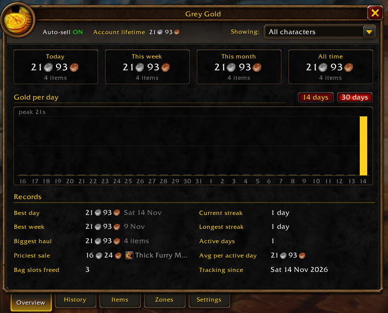
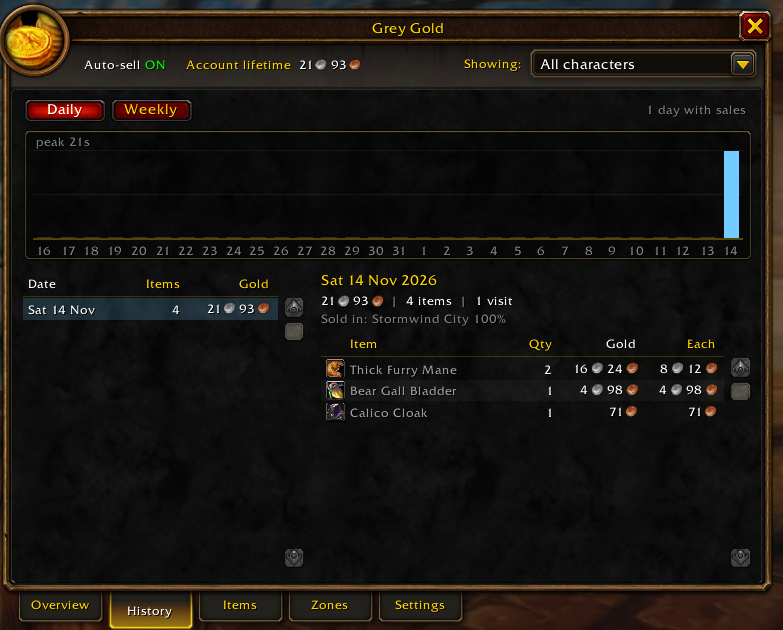
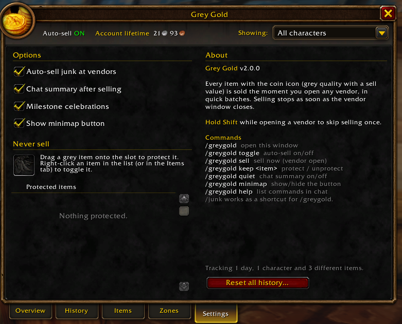

<p align="center">
  
</p>

# Grey Gold (WoW Forever)

Sells every junk item (grey quality, the items that show the gold coin icon) as soon as you open any vendor. It also keeps a history of what you sold, so you can browse your junk income by day, week, item and zone. A sales log shows when each item was sold and which mob, chest or catch it came from.

<p align="center">
  
</p>

## Installation

Pick **one** of the two ways below. Option A is the easiest.

### Option A: with the CurseForge app (easiest)

1. Install the free [CurseForge app](https://www.curseforge.com/download/app) and open it.
2. Choose **World of Warcraft**, then make sure **Forever** is selected as the game version (not Retail or Classic).
3. Search for **Grey Gold** and click **Install**.
4. Start (or fully restart) WoW. Done! The app also keeps the addon updated for you.

### Option B: install it yourself

1. **Download the zip.** Get the latest file from the addon's CurseForge page (**Files** tab).

2. **Find your AddOns folder.** Open the Battle.net app, select **World of Warcraft**, choose **WoW Forever** as the version, click the **gear icon** next to the Play button, and choose **Show in Explorer** (Mac: **Show in Finder**). In the folder that opens, go to:

   ```
   _forever_ > Interface > AddOns
   ```

   If `Interface` or `AddOns` doesn't exist yet, create it yourself (right-click > New > Folder). The names must be spelled exactly like this.

   > The usual location on Windows is `C:\Program Files (x86)\World of Warcraft\_forever_\Interface\AddOns`, and on Mac it's `/Applications/World of Warcraft/_forever_/Interface/AddOns`.

3. **Copy the addon in.** Open the zip (double-click it). Inside is a folder called `GreyGold`. Drag that **folder** into your `AddOns` folder.

   When you're done, it must look exactly like this:

   ```
   AddOns
   └── GreyGold
       ├── GreyGold.toc
       ├── GreyGold.lua
       └── ... (the other files)
   ```

   **Common mistakes:**
   - A folder inside a folder, like `AddOns\GreyGold\GreyGold\...` or `AddOns\GreyGold-2.0.0\GreyGold\...`. Move the inner `GreyGold` folder up so it sits directly in `AddOns`.
   - The wrong folder name. Downloads from GitHub are called something like `...-main`. Rename the folder to exactly `GreyGold`, or WoW won't load it.
   - The files dropped loose into `AddOns` without the `GreyGold` folder around them.

4. **Restart WoW completely.** Close the game and start it again; typing `/reload` is not enough for a newly installed addon.

5. **Check that it's turned on.** On the character select screen, click **AddOns** (bottom left) and make sure **Grey Gold** is ticked. If it says *Out of date*, tick **Load out of date AddOns** at the top of that list.

## Getting started

You don't need to set anything up. Just play:

1. **Open any vendor.** Grey Gold sells all your grey junk right away, and a chat message tells you how much you earned. (Want to keep your junk this one time? Hold **Shift** while you click the vendor.)
2. **See your stats.** Click the **gold coin button** on the edge of your minimap, or type `/greygold` in chat.
3. **Protect an item you want to keep.** Open the **Settings** tab and drag the item onto the **Never sell** slot. It will never be sold.
4. **Turn auto-selling off or on** any time: **Shift-click** the minimap button, or type `/greygold toggle`.
5. **See where your junk came from.** The **Log** tab lists every sale with its date and time, and the mob (or chest, catch, mail...) the item came from.

### Something not working?

| Problem | What to do |
| --- | --- |
| Grey Gold isn't in the AddOns list | Check the folder layout in step 3 above, then fully restart WoW. |
| It's in the list but marked *Out of date* | Tick **Load out of date AddOns** on the AddOns screen. |
| Nothing gets sold | Make sure auto-sell is **ON** (hover over the minimap button), that you weren't holding Shift, and that the item isn't on your Never sell list. Only **grey** items are sold. |
| I can't see the minimap button | Type `/greygold minimap` to show it again. |

### Updating and removing

- **Update:** with the CurseForge app, click **Update**. Manually, delete the old `GreyGold` folder and copy in the new one. Your history is saved separately, so it stays.
- **Remove:** delete the `GreyGold` folder from `AddOns`. To also delete your saved history, remove `GreyGold.lua` from `_forever_\WTF\Account\<your account>\SavedVariables\`.

## FAQ

**I sold something by mistake. Can I get it back?**
Yes, if you act before logging out. Open the vendor's **Buyback** tab: the game keeps your last 12 sold items there until you log out. Grey Gold notices the buyback and takes that sale back out of your totals; the Log marks it **Bought back**. Then add the item to your **Never sell** list, or the next vendor will sell it again (that sale shows up as **Re-sold**, still with the mob it came from).

**Do grey items I sell myself count?**
Yes. Grey items you sell by hand (right-click or drag them to the vendor, for example after opening it with Shift held, or protected items) are recorded like any other sale and count toward your milestones. They are marked **By hand** in the Log. An item only counts once the vendor has actually paid for it, so destroying or equipping a grey item never counts as a sale, even with the vendor open. Only grey items are recorded; selling anything better is ignored.

**Will it sell anything that isn't grey?**
No. Only grey (Poor quality) items that have a sell value are sold: the ones that show the gold coin icon at a vendor. Your gear, consumables and anything better than grey are never touched.

**What about grey items I want to keep, like transmog pieces?**
Put them on the **Never sell** list: drag the item onto the slot in the **Settings** tab, right-click it in the **Items** tab, or type `/greygold keep` followed by a space and shift-click the item into chat.

**Is it safe to use?**
Grey Gold only sells while a vendor window is open, using the same action as right-clicking an item at a vendor. It stops the moment you close the vendor.

**Does it share my data with anyone?**
No. Your history and settings are saved only on your own PC, and the addon never sends anything anywhere.

**Are the settings per character?**
No. Your settings and Never sell list are shared by all characters on your account. Your history is recorded per character, and the **Showing** dropdown lets you view one character or all of them together.

**Does it work with bag addons like Bagnon?**
Yes. Grey Gold reads your bags directly from the game, so it works the same with or without a bag addon. It can also show the junk in your bags right now inside the bag window:
- **Bagnon** (and other addons with a data bar): Bagnon's bag window has a data bar at the bottom. Click its **<** or **>** arrows until **Grey Gold** appears. It shows how many junk items you carry and what they're worth.
- **Default bags**: a small **Junk** label appears next to your backpack. You can turn it off in **Settings**.

**Does it work on Retail or Classic?**
Grey Gold is made for **WoW Forever**. Other game versions aren't supported.

**I hid the minimap button. How do I open the window now?**
Type `/greygold`, or use the addon list button next to the minimap (the addon compartment). `/greygold minimap` brings the button back.

## Minimap button

Drag the button to move it around the minimap edge. It works with round and square minimaps. The same actions are also available from the addon compartment.

| Action      | What it does             |
| ----------- | ------------------------ |
| Left-click  | Open the stats window    |
| Right-click | Open the Settings tab    |
| Shift-click | Turn auto-sell on or off |
| Hover       | See today, this week and all-time gold, the junk in your bags right now, and how far you are from the next milestone |

## Stats window (`/greygold`)

The **Showing** dropdown switches between **All characters** and any single character.

- **Overview**: tiles for today, this week, this month and all time; a bar showing your next milestone and how much is left to reach it; a gold-per-day chart (14 or 30 days; click a bar to open that day); and records:
  - best day and best week;
  - biggest vendor haul and priciest single sale;
  - current and longest selling streak;
  - bag slots freed, active days, average per active day, and the date tracking started.
- **History**: daily or weekly view with a chart and a list of periods. Selecting a period shows each item sold that day or week (quantity, gold, gold per item) and which zones you sold it in.
- **Items**: a leaderboard you can sort and search, for **Today**, **This week**, the **last 30 days** or **All time**. Shift-click links an item in chat; right-click protects it from selling.
- **Zones**: the same four date filters, and two views:
  - **Farmed in**: where you looted the junk you sold (gold, items, gold per item, share). Only junk you looted yourself counts here: from mobs, chests, fishing and containers. Mailed, traded or banked junk, and junk that was already in your bags when you installed 2.1.0, still counts as a sale everywhere else but gives no zone credit.
  - **Sold in**: where you were when you sold it (gold, vendor visits, gold per visit, share).
- **Log**: every sale, newest first: date and time, item, quantity, gold, where it came from, and a note (**By hand**, **Bought back** or **Re-sold**). Hover a row to see when and where it was looted and where it was sold. Search by item or by mob name. The log starts with version 2.1.0 and keeps the last 2,000 sales per character (the newest 500 are shown at once); your daily totals are kept forever.
- **Settings**: the options, the never-sell list (drag an item onto the slot), the slash commands, and a reset button. Reset clears the history for whichever scope the dropdown is showing.

When your lifetime junk gold passes 10g, 25g, 50g, 100g, 250g and so on, you get a milestone message and a coin sound. Every grey item you sell counts, whether Grey Gold sold it or you did.

When your bags are full, Grey Gold names your cheapest junk stack in chat, so you know what to delete to make room. It never deletes anything itself, and you can turn the hint off in **Settings**.

<details>
<summary><b>Screenshots of every tab</b> (click to open)</summary>

**History**: every item sold on a chosen day or week, and where you sold it



**Items**: all-time leaderboard of your junk


**Zones**: where you sold your junk


**Settings**: options, never-sell list and commands



</details>

## Commands

| Command                 | What it does                                            |
| ----------------------- | ------------------------------------------------------- |
| `/greygold`             | Open or close the stats window                          |
| `/greygold toggle`      | Turn auto-sell on or off                                |
| `/greygold sell`        | Sell junk now (a vendor must be open)                   |
| `/greygold keep <item>` | Protect or unprotect an item (shift-click it into chat) |
| `/greygold quiet`       | Turn the chat summary on or off                         |
| `/greygold minimap`     | Show or hide the minimap button                         |
| `/greygold help`        | List the commands in chat                               |

`/junk` works as a shortcut for `/greygold`, so `/junk sell` and `/greygold sell` do the same thing.

Hold **Shift** while opening a vendor to skip auto-selling that one time.

## How it works

- An item counts as junk when it has Poor quality, has a sell value, and is not on your never-sell list. This is the same rule the game uses for the coin icon.
- Sales go out in batches of 12 every 0.2s, and failed sales are retried. Selling stops the moment the vendor window closes, because outside a vendor the game would use or equip the item instead.
- Only sales the server confirms (the item has left your bags) are recorded.
- Grey items you sell by hand are recorded once the vendor's payment arrives. Items that leave your bags without a payment (destroyed, equipped, used) are not sales. Gold from selling anything that isn't grey is never counted.
- When junk arrives in your bags, Grey Gold notes where it came from: the mob, chest, fishing catch or container you looted, or mail, trade, the bank or "other". When you sell it, the oldest copies are matched first, so a stack from three different mobs becomes three Log rows. Mob names come from units you have hovered, targeted or seen a nameplate for; inside dungeons the game can hide them, and the Log then says "Unknown creature".
- A buyback from the vendor's Buyback tab takes that sale back out of the daily, item, zone and character totals. Milestones you already reached stay reached. If you buy something back while auto-sell is still running, the run stops so the item isn't sold again at once; `/greygold sell` sells the rest.
- History is saved account-wide in `GreyGoldDB`, one entry per item per day per character, plus the sales log. No libraries are bundled. The Bagnon data-bar feed is only offered when another addon (such as Bagnon) provides the library. The window is only built the first time you open it.

## Feedback and bug reports

Found a bug or have an idea? [Open an issue on GitHub](../../issues) or leave a comment on the CurseForge page.

To help me fix a bug quickly, please include:
- **Your Grey Gold version.** You can see it in the title bar of the stats window, or in the **Settings** tab under About.
- **What you did and what happened.** For example: "I opened a vendor and nothing was sold."
- **Any error message.** If you don't see errors, type `/console scriptErrors 1` in chat to turn them on, then try again.

## Changelog

### 2.1.0
- New **Log** tab: every sale with date and time, and the mob, chest, catch, container, mail, trade or bank it came from. Notes for hand sales, buybacks and re-sales.
- **Zones** tab: new **Farmed in** view (where you looted your junk) next to **Sold in**. Only junk you looted yourself gets zone credit.
- **Items** and **Zones** tabs: Today, This week, last 30 days and All time filters.
- Grey items you sell by hand now count, but only once the vendor pays. Destroyed or equipped greys never count, and nothing better than grey is ever recorded.
- Buying an item back takes that sale out of your totals.
- Next-milestone progress bar on the Overview, and in the minimap tooltip.
- Junk in your bags right now: a data feed for Bagnon's data bar (and similar addons), and a small label next to the default backpack.
- When your bags are full, a chat hint names your cheapest junk stack.
- The window title shows the version number.
- The Settings tab moved from 5th to 6th place.

### 2.0.0: first release
- Auto-sells every grey item the moment you open a vendor, in quick batches, and stops when the vendor closes.
- Never sell list, Shift to skip selling once, and an optional chat summary.
- Stats window with Overview, History, Items and Zones tabs, plus records, streaks and milestones.
- Minimap button and addon compartment entry.

## License

MIT. See [LICENSE](LICENSE).

## Disclaimer

This addon is provided "as is", without warranty of any kind, express or implied. You use it at your own risk. To the fullest extent permitted by applicable law, the author accepts no responsibility or liability for any loss, damage or other consequence arising from its use, including items sold by mistake, lost gold or data, or any action taken against your game account.
